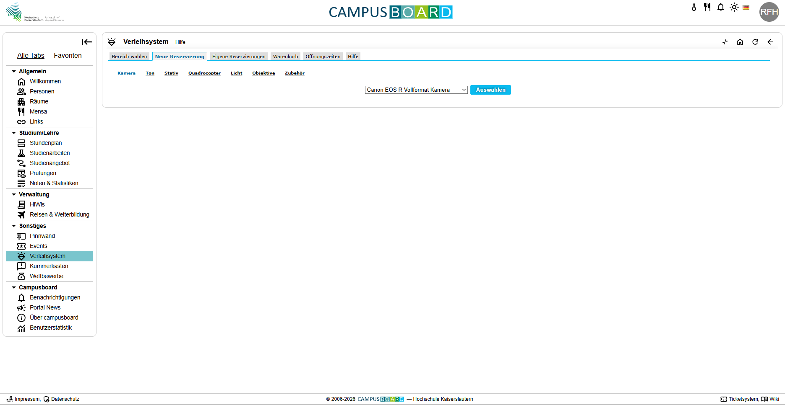

Bei diesem Produkt handelt es sich um das Verleihsystem, für allerlei Equipment, auf der Campusboard Webseite.

Es kann, nach Anmeldung mit einem Hochschulaccount Von jedem verwendet werderden.
Verwendet wird das System von Student und Dozenten gelicher Maßen und verfügt über ein breites Angebot. Das Equipment wird meist für Abgaben oder Gruppenarbeiten gebraucht.

Bei der Betrachtung der Startseite des Verleihsystems wird direkt ersichtlich welche Optionen das System einen bietet und überfordert nicht mit einem überladenen UI oder "zu vielen Möglichkeiten". Dieser Erste Eindruck und Aufbau ist der erste Schritt für ein zufriedenstellendes Erlebnis beim Benutzen des Verleihsystems. Zudem wird die, zum ausleih verfügbare, Ausrüstung in verschiedene Kategorien Geteilt, wie z.B.: Kamer, Ton, Stativ, Quadcopter, Licht, Objektiv und Zubehör.

Durch diese Aufteilung ist die List der Verfügbaren Dinge überischtlich und effizent, man findet intuitiv das richtige Equipment. Sobald ein Objekt ausgesucht wurde wieht man eine Detailseite, auf dieser lässt sich direkt Zubehör für besagtes Objekt dazubuchen, was im umkehrschluss Zeit spart und das Ausleiherlebnis flüssiger sein lässt. Durch eine Liste von Zugehör welches von Haus aus bei dem Objekt dabei ist, lässt sich ein doppeltes Buchen von Zubehör vermeiden.