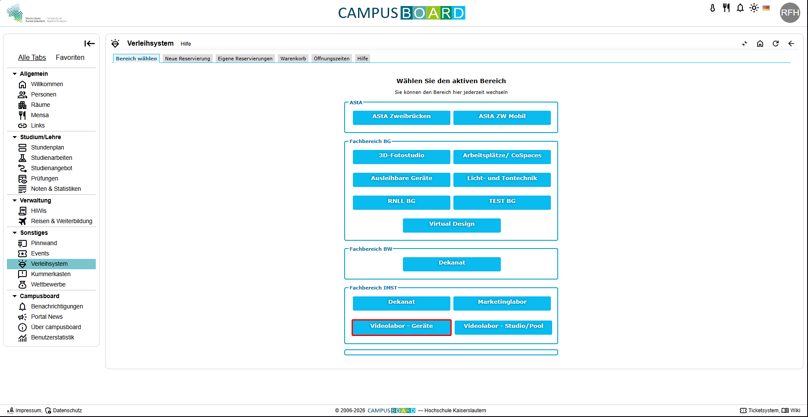
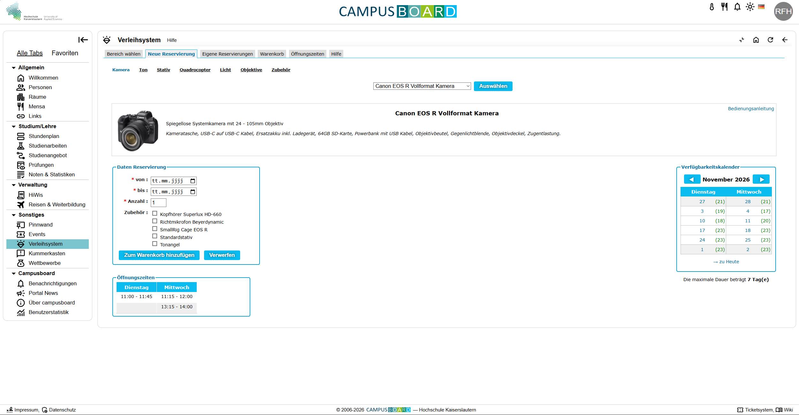
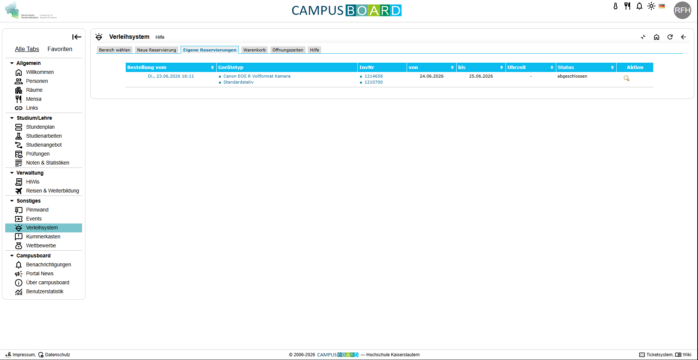

Bei diesem Produkt handelt es sich um das Verleihsystem, für allerlei Equipment, auf der Campusboard Webseite.

Es kann, nach Anmeldung mit einem Hochschulaccount Von jedem verwendet werderden.
Verwendet wird das System von Student und Dozenten gelicher Maßen und verfügt über ein breites Angebot. Das Equipment wird meist für Abgaben oder Gruppenarbeiten gebraucht.
#### Achtung
#### Um den Rahmen dieses Exemples nicht zu überschreiten wird nur der Bereich des "Videolabor - Geräte" der IMST betrachtet, da der Aufbau und die Bedienung der Restlichen Bereiche gleich ist. 

Die verschiedenen Bereiche des Verleihsystems können über den "Bereich Wählen Tab" eingesehen werden (s.o.).

Bei der Betrachtung der Startseite des Verleihsystems (s.o.) wird direkt ersichtlich welche Optionen das System einen bietet und überfordert nicht mit einem überladenen UI oder "zu vielen Möglichkeiten". Dieser Erste Eindruck und Aufbau ist der erste Schritt für ein zufriedenstellendes Erlebnis beim Benutzen des Verleihsystems. Zudem wird die, zum ausleih verfügbare, Ausrüstung in verschiedene Kategorien Geteilt, wie z.B.: Kamer, Ton, Stativ, Quadcopter, Licht, Objektiv und Zubehör.

Durch diese Aufteilung ist die List der Verfügbaren Dinge überischtlich und effizent, man findet intuitiv das richtige Equipment. Sobald ein Objekt ausgesucht wurde wieht man eine Detailseite, auf dieser lässt sich direkt Zubehör für besagtes Objekt dazubuchen, was im umkehrschluss Zeit spart und das Ausleiherlebnis flüssiger sein lässt. Durch eine Liste von Zugehör welches von Haus aus bei dem Objekt dabei ist, lässt sich ein doppeltes Buchen von Zubehör vermeiden.

Auf der Detailseite (s.o.) werden einem in übersichtlichen kleineren Fenstern alle nötigen Informatione mitgegeben, welche man braucht um etwas auszuleihen. Auf der Rechnten Seite findet sich ein Vewrfügbarkeitskalender, dieser ist nach Wochentag geortnet und gibt in der Klammer die Anzahl verfügbarer Einheiten zum ausleihen an. Unterhlab dieses Kalenders wird der Hinweis gegeben das die maximale Ausleih dauer 7 Tage beträgt. 

Am linken Rand der Seite sieht man zwei kleine Fenster, eines mit den Reservierungsdetails und eines mit den Öffnungszeit zum Abholen der Sachen.
Angefangen mit den Reservierungsdetails, lassen sich die Daten eintragen zu welchen der Ausleihzeitraum anfängt und endet, sowie sich die Anzahl an Einheiten anpassen lässt. So dass nicht für jede Einheit eine neue Reservierung eingereicht werden muss.
Um dieses Sytsem zu unterstutzen gibt es einen Warenkrob mit dem mehrere Ausleihanträge auf einmal gestellt werden können, die möglichkeit das aktuell ausgewählte Objekt dirket dem Warenkorb hinzuzufügen bzw. zu verwerfen findet sich als Button im Fenster mit den Details wieder. DerWarenkorb kann über den, oben sichtbaren, Tab "Warenkorb" eingesehen werden.

Sobald eine, oder mehrere, Reservierungen eingereicht wurden könne dieser über den Tab "Eigene Reservierungen" Direkt oben eingesehen werden. Hier finden sich allerleih Daten zur Reservierung wieder, darunter das Datum, die Uhrzeit, Was ausgeliehen wurde aber auch der Status der Reservierungen(s.o.). Dies hilft um nachzuverfolgen wann und wie die Geräte von einem selbst verwendet wurden.
All das hilft einem den Überblick auf der Seite zu behalten.

Die Bedienugn der Seite wird durch ein Durchgehend Konsistentes Design Schema unterstützt, Schaltfrächen oder Informative Stellen sind in der Primärfarbe eingefärbt, dies Sieht die Aufmerksamkeit des Users auf dies Flächen.

Wie alle Dinge im Leben ist auch diese Seite nicht Fehlerfrei, und es lassen sich Kleinigkeiten finden die man Verbessern könnte. Für User mit eingeschränkter Sicht lässt sich nicht auf anhieb ein Unterstüzender Modus finden. User mit körperlichen einschränkungen wie z.B.: Schnappfinger könnten auf Schwierigkeiten treffen mit Kleineren schaltflächen wie den Tabs am oberen Rand der Seite. Hinweiße auf erschwerte Bedinung von Kameras oder ähmlichem Equipment sind auf der Seite auch nicht zu finden. 

Jedoch sollte dazu erwähnt sein das der Nutzungsrahmen der Seite ein Interagieren von Usern mit diesen Einschränkungen höchst unwarscheinlich ist. 

Bassierend auf diesen Punkten und der mininalen Problematiken ordnen wir dieser Webseite eine gute Usability zu.