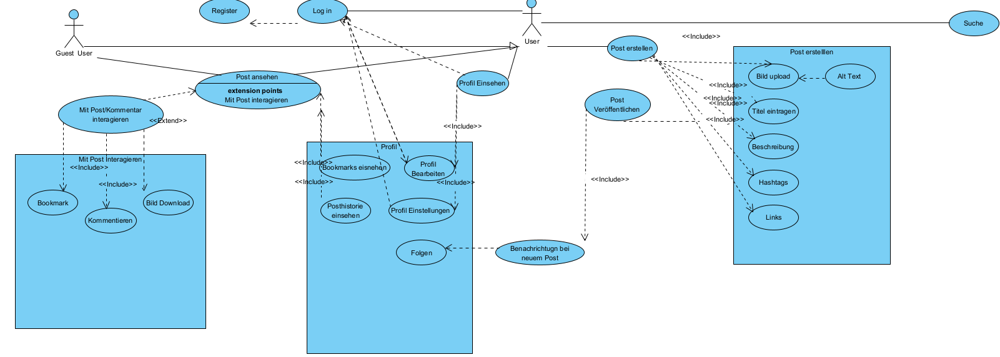

## Nr. 1a)
### Akteure:
 - User
 - Guest User

### Use-Cases:
#### Anmelden:
 - Login
 - Registrieren

#### Post Erstellen:
 - Post erstellen
 - Bild upload
    - Alt Text
 - Titel
 - Beschreibung
 - Hashtags
 - Links
 - Post Veröffentlichen
 - Benachrichtigung senden

#### Post Interaktion:
 - Bookmark
 - Kommentieren
 - Bild Downloaden

#### Profil einsehen:
 - Profil einsehen
 - Bookmarks einsehen
 - Posthistorie einsehen
 - Folgen
 - Profil Einstellungen
 - Profil Bearbeiten

#### Sonstiges:
 - Suche

## Nr. 1 b)

## Nr. 1 c)

|||
|-|-|
|Name||
|Nachbed. im Erfolgsfall||
|Nachbed. bei Fehlschlag||
|Akteur/e||
|Auslösendes Ereignis||
|Beschreibung||
|Erweiterungen/Alternativen||

|||
|-|-|
|Name|Login|
|Nachbed. im Erfolgsfall|User wird angemeldet|
|Nachbed. bei Fehlschlag|Aufforderung zur neueingabe der Credentials|
|Akteur/e|User|
|Auslösendes Ereignis|User klickt Button|
|Beschreibung|1. Nutzer gibt Email und Passwort ein   2. Nutzer Schickt Credentials ab   3. Nutzer ist Angemeldet|
|Erweiterungen/Alternativen|1. Schließen der Login Maske   2. Weiterleitung zur Registirerung|

|||
|-|-|
|Name|Registrieren|
|Nachbed. im Erfolgsfall| 1. Anmeldeverfahren wird durchlaufen   2. Userkonto wurde erstellt und User ist nun angemeldet|
|Nachbed. bei Fehlschlag| Erromeldung mit Ereigniscode und Kurz-Beschreibung|
|Akteur/e|Guest User|
|Auslösendes Ereignis|Guest User Klickt Button|
|Beschreibung|1. Der Nutzer gibt einen @ seiner Wahl ein   2. Nutzer gibt Email Adresse ein   3. Nutzer gibt Passwort ein   4. Nutzer klickt auf beenden|
|Erweiterungen/Alternativen|1. Abbrechen|

|||
|-|-|
|Name|Post erstellen|
|Nachbed. im Erfolgsfall|Eine Maske für das erstellen eines neuen Posts öffnet|
|Nachbed. bei Fehlschlag|Popup-Fehlermeldung mit "Da ist etwas schief gelaufen :/"|
|Akteur/e|User|
|Auslösendes Ereignis|Klick auf den Button "Neuen Post erstellen"|
|Beschreibung|Eine Maske für das erstellen eines neuen Posts mit den Unterkategorien Bild upload-Alt Text, Titel, Beschreibung, Hashtag, Links, Post Veröffentlichung|
|Erweiterungen/Alternativen|Benachrichtigung Senden|

|||
|-|-|
|Name|Bild Upload|
|Nachbed. im Erfolgsfall|Bild wurder erfolgreich hochgeladen|
|Nachbed. bei Fehlschlag|Popup Fehlermeldung "Beim Hochladen des Bildes ist etwas schief gelaufen :/"|
|Akteur/e|User|
|Auslösendes Ereignis|Anwählen der Schalffläche "Bild hochladen" (Button, Drag and Drop Menu)|
|Beschreibung|1a. Bild über Drag & drop Menu ziehen   1b. Klicklen des "Datei auswählen" Buttons|
|Erweiterungen/Alternativen|1. Weiteres Bild hochladen   2. Alt Text hinzufügen    "Content Warning" Hinzufügen (Bruled das Bild im Feed falls es NSFW ist)|

|||
|-|-|
|Name||
|Nachbed. im Erfolgsfall||
|Nachbed. bei Fehlschlag||
|Akteur/e||
|Auslösendes Ereignis||
|Beschreibung||
|Erweiterungen/Alternativen||

#### Post Erstellen:
 - Post erstellen
 - Bild upload
    - Alt Text
 - Titel
 - Beschreibung
 - Hashtags
 - Links
 - Post Veröffentlichen
 - Benachrichtigung senden
 